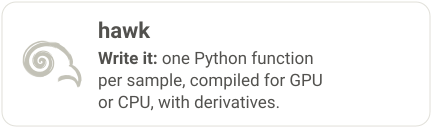
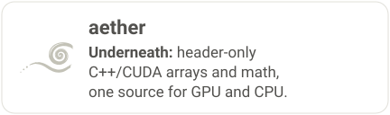
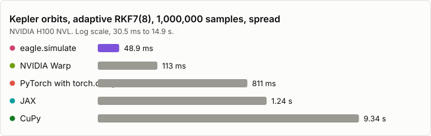

<p align="center">
  
</p>
<h1 align="center">eagle</h1>
<p align="center">Runs kernels on CPU and GPU, with precise control. Part of the RAPTOR family.</p>
<p align="center">Linux and macOS wheels; on Windows, use WSL2.</p>

<h3 align="center">eagle: run a million per-sample kernels on the GPU or the CPU</h3>
<p align="center">Each sample stops when it is done. eagle records the loop on the GPU once, replays it,
and skips the samples that already finished.</p>

<p align="center">
  <a href="https://github.com/amasat01/eagle/actions/workflows/ci.yml"></a>
  <a href="https://amasat01.github.io/eagle/"></a>
  <a href="https://github.com/amasat01/eagle/blob/main/LICENSE"></a>
  <a href="https://pypi.org/project/raptor-eagle/"></a>
  <a href="https://doi.org/10.5281/zenodo.23250240"></a>
  <a href="https://www.kaggle.com/kernels/welcome?src=https://github.com/amasat01/eagle/blob/main/docs/content/userguide/quickstart_python.ipynb"></a>
</p>

<p align="center">
  <a href="https://amasat01.github.io/"><b>The RAPTOR family</b></a><br>
  <a href="https://amasat01.github.io/hawk/"><picture><source media="(prefers-color-scheme: dark)" srcset="https://raw.githubusercontent.com/amasat01/eagle/main/docs/_static/ecosystem/ecosystem_card_hawk_eagle_dark.svg"></picture></a>
  <a href="https://amasat01.github.io/eagle/"><picture><source media="(prefers-color-scheme: dark)" srcset="https://raw.githubusercontent.com/amasat01/eagle/main/docs/_static/ecosystem/ecosystem_card_eagle_eagle_dark.svg"></picture></a><br>
  <a href="https://amasat01.github.io/aether/"><picture><source media="(prefers-color-scheme: dark)" srcset="https://raw.githubusercontent.com/amasat01/eagle/main/docs/_static/ecosystem/ecosystem_card_aether_eagle_dark.svg"></picture></a>
  <a href="https://amasat01.github.io/raptor/"><picture><source media="(prefers-color-scheme: dark)" srcset="https://raw.githubusercontent.com/amasat01/eagle/main/docs/_static/ecosystem/ecosystem_card_raptor_eagle_dark.svg"></picture></a>
</p>

eagle is the execution layer of the [RAPTOR family](https://amasat01.github.io/): it captures and replays kernels
as CUDA graphs to keep work efficient on the GPU, and connects them to the code you already have. See
[where RAPTOR fits](https://amasat01.github.io/where_raptor_fits.html) for the full four-part story.

Wheels for Linux x86_64 and aarch64 and macOS arm64 (Python 3.9-3.15); the GPU plugin is in the Linux wheels, x86_64 and aarch64 (the aarch64 plugin is built and load-tested without a GPU; it has not run on one). **On Windows, use WSL2** (the Linux wheels), or open the notebook on Colab or Kaggle (the Kaggle badge above).

```bash
pip install raptor-eagle raptor-hawk                           # CPU threads, no NVIDIA packages
pip install "raptor-eagle[cuda12]" "raptor-hawk[cuda12]"       # NVIDIA GPU ([cuda13] for a CUDA 13 driver)
```

A kernel, run over an array, then two kernels as one graph (NumPy arrays, so it runs on the CPU):

```python
import numpy as np
import eagle
import hawk
from hawk import Param, Scalar


@hawk.kernel
def scale(x: Scalar, a: Param, b: Param) -> Scalar:
    return a * x + b


@hawk.kernel
def square(v: Scalar) -> Scalar:
    return v * v


x = np.arange(4.0)
print(eagle.deploy(scale).run(x=x, a=2.0, b=1.0))        # [1. 3. 5. 7.]


@eagle.Graph.builder
def chain(x):
    g = eagle.Graph()
    g.result = square(scale(x, 2.0, 1.0))
    return g


g = chain(x)                                             # build: records, runs nothing
print(g())                                               # [ 1.  9. 25. 49.]
```

The same lines with CuPy arrays make a CUDA graph: the arrays decide where it runs.
The [graph model](https://amasat01.github.io/eagle/content/userguide/graph_model.html)
has branches, device-side `if` and `while`, `bind` and gradients.

On a GPU, `eagle.simulate` runs a million per-sample loops, each stopping at its own step:

```python
import cupy as cp

import eagle
import hawk
from hawk import Mutable, Param, Scalar, Terminated


@hawk.kernel
def oscillator(omega: Scalar, t_end: Param, dt: Param, terminated: Terminated,
               x: Mutable[Scalar], v: Mutable[Scalar], t: Mutable[Scalar]):
    x0, v0 = x, v
    x = x0 + dt * v0
    v = v0 - dt * omega * omega * x0
    t += dt
    terminated = t >= t_end


n = 1_000_000
result = eagle.simulate(
    oscillator,
    omega=cp.linspace(1.0, 3.0, n), t_end=1.0, dt=1e-3,
    x=cp.ones(n), v=cp.zeros(n), t=cp.zeros(n),
    max_steps=10_000,
)
print(result.status, result.steps, result.x[:3])
# finished 1000 [0.54057281 0.54057112 0.54056944]
# (steps counts whole check intervals, so it varies with the launch strategy eagle picks; x does not)
```

With NumPy arrays the same call runs on CPU threads (`steps` then prints 1024, not 1000: it counts whole check intervals, which differ by route).

Errors: `no CUDA GPU visible` means there is no GPU (or `CUDA_VISIBLE_DEVICES` hides it); `cudaErrorInsufficientDriver` means the
installed extra does not match the driver, so install `raptor-eagle[cuda12]` for a CUDA 12 driver or `[cuda13]` for CUDA 13.

With the `[torch]` extra, a hawk kernel works inside PyTorch autograd:

```python
import torch
import hawk
from hawk import Mutable, Scalar
from eagle.frameworks import torch as eagle_torch


@hawk.kernel
def decay(k: Scalar, x: Scalar, x_next: Mutable[Scalar]):
    x_next = x * (1.0 - k)


step = eagle_torch.function(decay, wrt=("k",))
k = torch.full((1000,), 0.5, dtype=torch.float64, requires_grad=True)
x_next = step(k, torch.ones(1000, dtype=torch.float64))
x_next.sum().backward()
print(x_next[0].item(), k.grad[0].item())     # 0.5 -1.0
```

**[Quickstart](https://amasat01.github.io/eagle/content/userguide/quickstart_python.html)** ·
[Install](#install) · [Performance](#performance) · [C++ API](#c-api)

<!-- hero:begin -->
| **48.9 ms** at N = 1,000,000, 477 ms at N = 10,000,000 | **2.3×–190× faster** at N = 1,000,000, 2.3×–150× at N = 10,000,000 | **9.1×–30× less GPU memory** at N = 1,000,000, 12×–16× at N = 10,000,000 |
|:---:|:---:|:---:|
| RKF7(8) Kepler orbits, each stopping at its own time | than NVIDIA Warp (2.3×), JAX (25×), CuPy (190×), PyTorch with torch.compile (16×) at N = 1,000,000; Warp is level or ahead when every sample runs the same orbit | than CuPy and PyTorch with torch.compile: 102 MiB for N = 1,000,000, 1.4× the bare minimum state |

<sub>NVIDIA H100 NVL (card of 2026-11-05). NVIDIA Warp's per-thread kernel is the fastest GPU arm in 0 of 6 cells; on the dense batch (every sample the same orbit) at N = 1,000,000 it takes 55.1 ms and `eagle.simulate` 40.8 ms. See [every number, every arm](#performance).</sub>
<!-- hero:end -->

## What's new in 0.7.1

- Planes are allocated through the `aether` arrays from `aether-dsc`, now a base dependency: the GPU needs no extra package.
- The free of a plane is queued on its own stream and deferred during a graph capture.
- `bound.clear(*names)` zeroes a keyed output and its compensation term, also on a split kernel.
- hawk's new features reach eagle through the same kernels: per-lane linear algebra, broadcasting at `eagle.deploy`, a run-time first axis and `if ...: break`.
- Random kernels give different numbers than 0.7.0, because aether's random stream changed.

Full list in the [changelog](CHANGELOG.md).

## Gradients, certified

JAX (`grad`, `jit`, `vmap`, `jacfwd`, `jacrev`), PyTorch (`backward`, `torch.func`) and NVIDIA Warp (`wp.Tape`) differentiate through an eagle kernel, and each is certified against the same law written in that framework alone. NumPy and CuPy have no autodiff: pass your own `vjps=`. The [interoperability page](https://amasat01.github.io/eagle/content/interop.html) lists the certified rows, with tutorials for [JAX](https://amasat01.github.io/eagle/content/userguide/tutorials/jax_vmap_and_jacobians.html), [PyTorch](https://amasat01.github.io/eagle/content/userguide/tutorials/03_torch_training.html), [Warp](https://amasat01.github.io/eagle/content/userguide/tutorials/warp_kernel_in_a_graph.html) and [whole graphs](https://amasat01.github.io/eagle/content/userguide/tutorials/10_gradients_through_a_graph.html). To use your own CUDA graph inside an eagle graph, hand it over as a `child` node (see the Warp tutorial); eagle does not launch inside your capture.

## Threading

Free-threaded CPython (3.14t/3.15t) is supported: the compiled modules declare GIL-free operation and the GIL stays disabled after import. Any number of threads may call module-level functions, build, compile, plan and cache concurrently. Distinct objects may be used from distinct threads without synchronisation. One stateful object (a stream, capture, launcher, graph, composer, plan, pipeline, active set, host kernel or arg block) shared by several threads is memory-safe — its calls serialise and a consumed object raises — but the ORDER of those calls is the caller's responsibility, exactly as for a NumPy array or a CuPy stream. CUDA adds two rules of its own: a stream capture is begun, filled and ended by one thread, and while any capture is open no thread may synchronise the whole device (stream-level synchronisation is fine). GPU routes are supported on free-threaded 3.14; the CPU route runs elsewhere. CUDA graph capture is per thread: a nested capture on one thread raises, while two threads may capture concurrently.

## Install

```bash
pip install raptor-eagle raptor-hawk                      # CPU threads: no NVIDIA packages, nothing else to install
pip install "raptor-eagle[cuda12]" "raptor-hawk[cuda12]"  # NVIDIA GPU; [cuda13] for CUDA 13; add [torch] for PyTorch interop
```

Extras, platforms, driver and Python versions: [installation](https://amasat01.github.io/eagle/content/userguide/installation.html). Building from source: [build from source](https://amasat01.github.io/build_from_source.html). The C++ library is a separate CMake install; the Python package from source is under [Python package](#python-package) below.

<details>
<summary>C++ library: build, test, install</summary>

Requirements: CMake ≥ 3.20 and a C++23 compiler (GCC ≥ 12 or Clang ≥ 16); CUDA
mode also needs a CUDA toolkit 12.6 or newer (the performance cards record the toolkit each was built with), whose nvcc accepts host compilers only up to
its own ceiling (for example GCC 13 for CUDA 12.6; the ceiling differs per toolkit — pass `-DCMAKE_CUDA_HOST_COMPILER=<g++-13>`
if your default is newer). `aether` must already be installed into `PREFIX` (see
aether's README); `PREFIX` is the install directory (inside a conda environment,
use `${CONDA_PREFIX}`).

```bash
# Configure (CUDA/C++ mode, with tests)
cmake -DCMAKE_PREFIX_PATH=${PREFIX} -DEAGLE_BUILD_TESTS=ON -B build .

# Configure (pure C++ mode)
cmake -DCMAKE_PREFIX_PATH=${PREFIX} -DEAGLE_CPP_MODE=ON -DEAGLE_BUILD_TESTS=ON -B build .

# Build
cmake --build build

# Test — the same command CI runs (there is no ctest wiring)
tests/check_gate.sh cuda build/tests/eagle_tests     # or: cpp, for a CPP_MODE build

# Install
cmake --install build --prefix ${PREFIX}
```

The gate checks both the run and the test listing against the committed name list
`tests/expected_tests_<mode>.txt`, so a filtered or empty run cannot pass. After adding or removing tests,
regenerate that list from your build and commit it with the test change (removals also need `--allow-removals`):
`tests/check_gate.sh cuda build/tests/eagle_tests --remint`.

Downstream projects consume it with `find_package(eagle CONFIG REQUIRED)` and link `eagle::eagle`.
</details>

<details>
<summary>Build the Python package from source</summary>

The Python package (`raptor-eagle`, imported as `eagle`) has two compiled
parts: `eagle._core` is plain C++ (g++) and needs no CUDA toolkit, runtime or
driver, while `eagle/libeagle_cuda.so`, the CUDA plugin the core loads on
first use, is built with `nvcc` (pass `-DEAGLE_PYTHON_CUDA_PLUGIN=OFF` to
build the core alone) and at run time needs only the NVIDIA driver — it
bundles no CUDA runtime. The build needs `aether` installed in CUDA mode
(without `-DAETHER_CPP_MODE=ON`) plus eagle's own headers, both in `PREFIX`,
and `raptor` (`pip install raptor-core`, or a clone next to this one: `pip install ../raptor`).

```bash
cmake -DCMAKE_PREFIX_PATH=${PREFIX} -B build-hdr . && cmake --install build-hdr --prefix ${PREFIX}
pip install raptor-core         # or a clone of the raptor repository: pip install ../raptor
export CMAKE_PREFIX_PATH=${PREFIX}
# append ;-DCMAKE_CUDA_HOST_COMPILER=<g++-13> if your default compiler is newer than nvcc accepts
export SKBUILD_CMAKE_ARGS="-DCMAKE_CUDA_ARCHITECTURES=<your GPU's arch, e.g. 70>"
pip install -e ./python
pytest python/tests -m "not gpu and not interop_matrix"   # drop the -m filter on a GPU machine with cupy and torch
```
</details>

## C++ API

```cpp
#include <eagle/eagle.h>

__global__ void addOne(int* buf, int n) {
    int tid = threadIdx.x + blockIdx.x * blockDim.x;
    if (tid < n) buf[tid] += 1;
}

// Record a launch once, replay the captured graph many times.
eagle::cuda::Stream stream;
eagle::cuda::Graph graph;
graph.stream(stream.cuda());

eagle::cuda::StreamCapturer capturer(stream.cuda());
capturer.begin();
addOne<<<1, 64, 0, stream.cuda()>>>(buf, 64);
graph.addNode(eagle::cuda::CapturedGraph{ capturer.end() });

eagle::cuda::Launcher launcher = graph.launcher();
launcher.launch();          // cudaGraphLaunch — no per-call kernel-config overhead
launcher.synchronize();
```

**EAGLE** — *Extensible Adaptive Graph Launch Engine* — is a header-only C++23/CUDA library providing a
parallel-dispatch substrate for GPU batch workloads. It bundles the reusable launch machinery in one place:

- **CUDA-graph capture & launch** — record a stream of kernel launches once
  (`StreamCapturer`), assemble them into a dependency graph (`Graph`), and
  replay via an instantiated `Launcher` with microsecond-class per-launch
  re-tuning (`setLogicalSize`).
- **Stream primitives** — RAII `Stream`, `Event`, and host-callback wrappers.
- **OpenMP + SIMD host dispatch** — `eagle::cpu::Host` packet-batched launchers with
  masked / flag-aware variants for the pure-C++ path.
- **Scan / scatter / compaction** — `filtering::Scanner`, `filtering::Slice`,
  and the prefix-sum + scatter kernels behind stream compaction.
- **Reduction** — `eagle::cuda::Reduction` (multi-level GPU) and
  `eagle::cpu::Reduction` (cache-padded OpenMP).
- **PyTorch, JAX and Warp bridges** — kernels plug into `loss.backward()`,
  `torch.autograd.forward_ad`, `jax.grad`/`jacfwd` and `wp.Tape`, so reverse-mode and
  forward-mode derivatives run through the same dual-mode engine.
- **CPU deployment** — `eagle::cpu::PluginRegistry` loads host plugins (float64 and
  float32) from a manifest; see [embed a kernel](https://amasat01.github.io/eagle/content/userguide/cpp/c4_embed_a_kernel.html).

Like its sibling libraries it is **dual-mode**: the same API compiles as CUDA or as pure C++23 (OpenMP), selected
by `EAGLE_CPP_MODE`. The C++ core depends only on `aether`; the Python package (`raptor-eagle`) also depends on
`raptor`, whose schema constants it re-exports.

## Performance

<!-- stale-prose-gate:
benchmarks/perf_card/card_nvidia-h100-nvl.json: PENDING
-->

<!--ctx card=ensemble dev=h100 n=1e6 dist=spread-->
The ensemble card integrates a batch of two-body Kepler orbits with an adaptive RKF7(8) in float64, each sample stopping at
its own time, from 10^6 to 10^7 samples, on spread and uniform batches. Every arm is checked against the exact answer. The
arms are `eagle.simulate` (the arm above), the CUDA-graph device loop, its persistent-launch form, a CuPy masked loop, PyTorch
with CUDA graphs and with `torch.compile`, a JAX `jit(vmap(while_loop))`, and an NVIDIA Warp per-thread kernel. The CPU card
runs the same workload on CPU threads. Each arm runs in its own process; an arm that runs out of memory or needs more than
120 s per run is shown as such, not dropped. The feature card times one capability per row, at one batch size, against its
natural baseline.

[Where the performance comes from](https://amasat01.github.io/eagle/content/performance/mechanism.html) explains why eagle is
ahead where samples finish at different times and level where they do not. [What the cards cover](https://amasat01.github.io/eagle/content/performance/coverage.html)
lists every feature and the card row, profile stage or reason behind it.

<p align="center"><a href="https://amasat01.github.io/eagle/content/performance.html"><picture><source media="(prefers-color-scheme: dark)" srcset="https://raw.githubusercontent.com/amasat01/eagle/main/docs/_static/perf/readme_gpu-dark.svg"></picture></a></p>


The chart shows the reference device; [the performance page](https://amasat01.github.io/eagle/content/performance.html) has a tab for every device and CPU measured.


<!-- cards:begin -->
**NVIDIA H100 NVL, card of 2026-11-05**

| Distribution (N = 1,000,000) | Arm | wall (IQR) | attempts·samples/s | % of the device's top FP64 rate |
|---|---|---:|---:|---:|
| Spread (each sample stops at its own time) | eagle graph | 105 ms (116 µs) | 4.74 G | 37% |
| Spread (each sample stops at its own time) | hawk + eagle persistent | 49 ms (92 µs) | 10.2 G | 79% |
| Spread (each sample stops at its own time) | eagle.simulate (eagle picks the launch mode) | 48.9 ms (110 µs) | 10.2 G | 80% |
| Spread (each sample stops at its own time) | CuPy masked | 9.34 s (141 ms) | 53.4 M | <1% |
| Spread (each sample stops at its own time) | Warp per-thread kernel | 113 ms (130 µs) | 4.42 G | 34% |
| Uniform (every sample runs the same orbit) | eagle graph | 51.3 ms (83.6 µs) | 8.33 G | 65% |
| Uniform (every sample runs the same orbit) | hawk + eagle persistent | 40.8 ms (101 µs) | 10.5 G | 82% |
| Uniform (every sample runs the same orbit) | eagle.simulate (eagle picks the launch mode) | 40.8 ms (225 µs) | 10.5 G | 82% |
| Uniform (every sample runs the same orbit) | CuPy masked | 4.87 s (54.3 ms) | 87.9 M | <1% |
| Uniform (every sample runs the same orbit) | Warp per-thread kernel | 55.1 ms (67.9 µs) | 7.75 G | 60% |

Measured on:

- [NVIDIA H100 NVL](https://amasat01.github.io/eagle/content/performance.html#perf-card-gpu-nvidia-h100-nvl)
- [NVIDIA L4](https://amasat01.github.io/eagle/content/performance.html#perf-card-gpu-nvidia-l4)
- [AMD EPYC 9B45](https://amasat01.github.io/eagle/content/performance.html#perf-card-cpu-amd-epyc-9b45)
<!-- cards:end -->

<!-- cpu-cards:begin -->
**On a CPU alone: AMD EPYC 9B45, 16 logical CPUs, card of 2026-11-04**

| Arm (N = 1,000,000) | spread wall | uniform wall | vs eagle CPU, 8 threads (spread) |
|---|---:|---:|---:|
| eagle CPU, 8 threads | 3.69 s (2.05 ms) | 2.08 s (2.12 ms) | 1.0× |
| eagle CPU, 1 thread | 29.4 s (14.4 ms) | 16.5 s (2.75 ms) | 7.9× |
| Numba prange | 20.9 s (396 ms) | 17.9 s (265 ms) | 5.6× |
| JAX jit(vmap(while_loop)) | 60.4 s (7.88 ms) | 28.8 s (57.4 ms) | 16× |
<!-- cpu-cards:end -->

**Where each tool fits.** On a dense batch (uniform: every sample runs the same orbit) NVIDIA Warp's per-thread kernel is the
fastest GPU arm when it ties: <!--c wall arm=warp_kernel dist=uniform-->55.1 ms<!--/c--> against `eagle.simulate`'s
<!--c wall arm=eagle_simulate dist=uniform-->40.8 ms<!--/c--> at N = 1,000,000. On a spread batch, where samples finish at
different times, `eagle.simulate` takes <!--c wall arm=eagle_simulate-->48.9 ms<!--/c--> against Warp's
<!--c wall arm=warp_kernel-->113 ms<!--/c--> (<!--c x arm=warp_kernel den_arm=eagle_simulate-->2.3×<!--/c-->). A CuPy masked loop
needs <!--c wall arm=cupy_masked-->9.34 s<!--/c--> there. See [where RAPTOR fits](https://amasat01.github.io/where_raptor_fits.html)
for that comparison.

**Hardware caveat:** the tables and text above are measured on a <!--c spec field=device.name-->NVIDIA H100 NVL<!--/c-->, a data-centre
card (<!--c spec field=device.sm_count-->132<!--/c--> SMs). The method carries over unchanged to other GPUs; the absolute numbers,
and the crossover points between arms, differ from device to device, and the performance page has a tab for each one measured.

Full write-up, method and the per-N tables: [the performance page](https://amasat01.github.io/eagle/content/performance.html).

---
<p align="center">
  <b>hawk</b> write it ·
  <b>eagle</b> run it (this repo) ·
  <b>aether</b> the numerics core ·
  <b>raptor</b> the shared contracts —
  <a href="https://amasat01.github.io/">the RAPTOR family</a>
</p>

Apache-2.0 (see [`LICENSE`](https://github.com/amasat01/eagle/blob/main/LICENSE) and
[`NOTICE`](https://github.com/amasat01/eagle/blob/main/NOTICE)) · cite via "Cite this repository"
(`CITATION.cff`; every tagged release is archived on Zenodo: [doi:10.5281/zenodo.23250240](https://doi.org/10.5281/zenodo.23250240)) · built to
make GPU computing accessible on modest hardware, for research and education. Collaboration is the point, and a
citation is the currency — get in touch.
