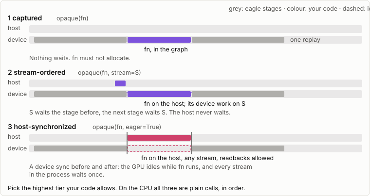
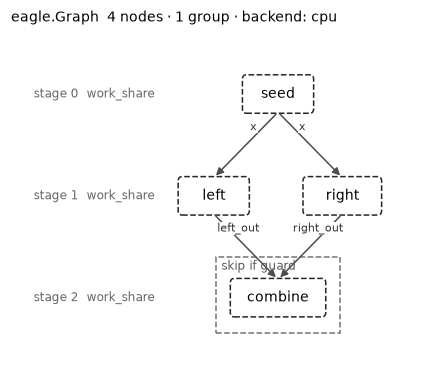

The graph model: ``eagle.Graph``
================================

.. contents:: On this page
   :local:
   :depth: 2

A real step is rarely one kernel. It is a propagation, then a diagnostic,
then maybe a branch that only some runs take, and two pieces of work that
have nothing to do with each other and could happen at the same time.
:class:`eagle.Graph` is where you write that down once and let eagle run it:
as a captured CUDA graph on the GPU, or as an ordered run of host launches
on the CPU. Same object, same calls, either way.

You add *nodes*. You never draw the *edges* between them: eagle reads which
arrays each node touches and works the ordering out for itself. That is the
one idea to carry through the page.

.. note::

   New to the pieces? :doc:`tutorials/09_graph_model` builds everything below
   step by step. :class:`~eagle.GraphPipeline` is unchanged: it is still
   the right tool when you want to record opaque callables yourself.

Write the graph as a function
-----------------------------

The shortest way to a graph is a function that calls your kernels. Decorate
it with ``@eagle.Graph.builder``, make an :class:`eagle.Graph` inside it, and
declare what comes out with ``g.result``:

.. code-block:: python

   import numpy as np
   import eagle
   import hawk
   from hawk import Param, Scalar

   @hawk.kernel
   def scale(x: Scalar, a: Param, b: Param) -> Scalar:
       return a * x + b

   @hawk.kernel
   def square(v: Scalar) -> Scalar:
       return v * v

   @eagle.Graph.builder
   def chain(x):
       g = eagle.Graph()
       g.result = square(scale(x, 2.0, 1.0))
       return g

   g = chain(np.arange(4.0))      # build: records the graph, runs nothing
   print(g())                     # run: (2x + 1)**2

.. code-block:: text

   [ 1.  9. 25. 49.]

Calling the builder on arrays builds the graph; calling the graph runs it and
returns ``result``. The arrays decide the backend (a host array is the CPU, a CUDA array is a
CUDA graph), and eagle works the edges out from which kernel reads what, as
below. Everything in the rest of this section is the same function with more
in it.

**New arrays, same graph.** ``bind`` swaps the arrays by the builder's
parameter names, in place: no copy and no rebuild. The shape and dtype must stay;
otherwise call the builder again. ``g(n)`` replays ``n`` times and returns the
result after the last.

.. code-block:: python

   g.bind(x=np.arange(4.0) + 1.0)
   print(g())
   print(g(10))

.. code-block:: text

   [ 9. 25. 49. 81.]
   [ 9. 25. 49. 81.]

**Branches that run at the same time.** ``g.parallel()`` opens a fork,
``p.branch()`` a branch, and leaving the ``with`` joins. A branch that needs
what another branch wrote says so with ``wait``, naming the array:

.. code-block:: python

   @eagle.Graph.builder
   def forked(x):
       g = eagle.Graph()
       a = dbl(x)
       with g.parallel() as p:
           with p.branch() as b:          # branch b: two nodes
               l = inc(a)
               l2 = dbl(l)
           with p.branch() as w:          # branch w starts once `l` is written
               w.wait(l)
               r = add(l, a)
       g.result = (l2, r)                 # after the join
       return g

(``inc``, ``dbl`` and ``add`` are one-line kernels like ``square``.) Two
branches that touch one array, one of them writing it, are refused unless one
waits for the other.

**Control flow on the device.** A 1-cell ``uint32`` array is a device
condition. ``if``, ``elif``, ``else``, ``while``, ``for`` with ``break`` and
``match`` on it become conditional nodes inside the one graph, read at every
replay. Plain Python values are decided once, at build, and a Python ``for``
is unrolled.

.. code-block:: python

   @eagle.Graph.builder
   def pick(x, flag, which):
       g = eagle.Graph()
       if flag:
           x = dbl(x)
       elif which:
           x = inc(x)
       else:
           x = add(x, x)
       g.result = x
       return g

   @eagle.Graph.builder
   def settle(x, flag):
       g = eagle.Graph()
       for _ in range(50):                # capped: at most 50 turns
           if not flag: break             # leave when the cell reads 0
           x = dbl(x)
           below(x, 100.0, flag)          # a kernel rewrites the cell
       g.result = x
       return g

Here ``below`` is a kernel that writes the guard through a ``Mutable[UInt32]``
(``flag = hm.uint32(hawk.sum(s < lim))``). Cap a loop with
``range(N)``: a bare ``while cell:`` works, but a body that never clears its
cell never returns, so eagle warns once. ``match`` on a cell takes literal
cases and ``_``:

.. code-block:: python

   @eagle.Graph.builder
   def chooser(x, sel):
       g = eagle.Graph()
       match sel:
           case 0:
               x = dbl(x)
           case 2:
               x = inc(x)
           case _:
               x = square(x)
       g.result = x
       return g

With ``pick(x, cell, which)``, setting ``cell[0] = 0`` and calling
``g()`` again takes the next arm with no rebuild.

**Keep an array: ``buffer=``.** A kernel's result is a temporary. Pass
``buffer=True`` to a kernel call and eagle keeps the array (or
``buffer=my_array`` to use yours). It stays readable after a run and becomes a
name a gradient can use.

**Gradients name what enters and leaves.** Build with ``record=True`` and
reverse. Seeds and ``wrt`` are always explicit: the seed is ``"result"`` (or
``"result.key"`` for a dict) an array a kernel wrote through a ``Mutable``, or a ``buffer=`` array;
``wrt`` names builder arguments or a top-level ``buffer=`` array (one made inside a loop or branch is not a key).

.. code-block:: python

   @eagle.Graph.builder
   def fit(x, record=False):
       g = eagle.Graph(record=record)
       a = scale(x, 2.0, 1.0, buffer=True)   # a name the gradient can use
       g.result = square(a)
       return g

   gr = fit(np.arange(4.0), record=True)
   gr()
   grads = eagle.diff.reverse(gr.record, {"result": np.ones(4)}, wrt=("x", "a"))
   print(grads["x"], grads["a"])

.. code-block:: text

   [ 4. 12. 20. 28.] [ 2.  6. 10. 14.]

A recorded graph runs with ``g()`` or ``launch()``, not ``enqueue``. Inside a
recorded loop, keep the body to kernels and cap the loop; the limits are listed
in :doc:`tutorials/10_gradients_through_a_graph`.

**Blocks.** A function with a parameter annotated ``eagle.Graph`` appends to
the graph it is given instead of making one, so builders can share pieces:

.. code-block:: python

   @eagle.Graph.builder
   def twice(g: eagle.Graph, v):
       return dbl(dbl(v))

Call it as ``twice(g, v)`` with the handle of the scope you are in (the
branch handle inside a branch). A block may also extend a hand-made graph,
which is the light way to give ``add`` and ``build`` code ``if`` and ``while``:

.. code-block:: python

   from eagle.graph import opaque

   x, y = np.arange(4.0), np.zeros(4)
   h = eagle.Graph()
   h.add_node(opaque(lambda: np.add(x, 1.0, out=y), reads={"x": x}, writes={"y": y}),
              name="shift")
   z = twice(h, y)               # two nodes, after `shift`
   h.build().launch()
   print(z)

.. code-block:: text

   [ 4.  8. 12. 16.]

A hand-made graph has no ``bind`` and no builder names; the next section is
that path in full.

When you need more: ``add`` and ``build``
-----------------------------------------

Everything above is built on the calls below, and they stay when you want
control of each node: plan launches you bound yourself, your own code as an
``opaque`` node, an explicit ``add_group``.

Your first hand-made graph
^^^^^^^^^^^^^^^^^^^^^^^^^^

.. code-block:: python

   import numpy as np
   import eagle
   from eagle.graph import opaque

   x, y, z = np.zeros(8), np.zeros(8), np.zeros(8)

   g = eagle.Graph()
   g.add_node(opaque(lambda: np.multiply(x, 2.0, out=y), reads={"x": x}, writes={"y": y}),
              name="double")
   g.add_node(opaque(lambda: np.add(y, 1.0, out=z), reads={"y": y}, writes={"z": z}),
              name="shift")
   g.build()
   g.launch()

``add_node`` takes a node; a plan launch is added with ``add(bound_plan)``
(a :class:`~eagle.plan.BoundPlan` from ``plan.bind(...)``). ``build()``
looks at where the planes live (host memory means the CPU, a CUDA array means the GPU),
derives the edges, refuses anything unsafe and lowers the graph.
``launch()`` runs it, ``launch(n)`` runs it ``n`` times. Every method returns
the graph, so a build reads as one chain.

Nodes
-----

Plan launches
^^^^^^^^^^^^^

``Graph.add(bound, name=...)`` appends one :class:`~eagle.plan.BoundPlan`.
Its planes are the arrays you bound it over, and each plane's role in the
kernel (read, write, or both) tells eagle how the node touches it. A plane
that would have to be *copied* before the launch (a non-contiguous or
sample-major array) is refused: a graph needs to see the very array you
hold, so pass a contiguous one.

To start a new epoch or replay with an empty sink, call
``bound.clear("acc")`` rather than zeroing ``acc`` yourself: it also zeroes
the compensation plane eagle keeps for a keyed sum, which you cannot reach.
Call it between launches or replays, not inside a captured graph.

``Graph.add(bound, grad=False)`` marks the launch as not differentiated, for
a node such as a controller that writes a step size. A recorded run and
:class:`eagle.diff.Reverse` skip it: it needs no vjp, nothing it reads is
saved, and no gradient goes back through its outputs. A differentiated node
may read what it writes only through a one-cell parameter plane; any other
plane is refused by name when the graph is built with ``record=True``.

A ``repeat_while`` body added with ``add_node`` may be a tuple of parts run in
order, and a part may be a ``skippable``: a loop can hold a step, a guarded
check and a controller. A loop inside a loop is refused. A reverse skips a loop
whose parts are all ``grad=False`` (build them with
``eagle.graph.opaque(..., grad=False)``); a loop with a differentiated part is
refused by name when it is reversed, so mark the controller ``grad=False`` or
place the differentiated part outside the loop.

Fork and join
^^^^^^^^^^^^^

``Graph.add_group([branch, branch, ...])`` is a stage: the branches may run
at the same time, and the next node waits for all of them. A branch is a
plan, a node, or a list of them (run in order inside the branch).

.. code-block:: python

   g.add_group([left_plan, right_plan], names=["left", "right"])

On the GPU the branches are captured as siblings, so the device can
overlap them. On the CPU they run one after another in add order, and the
result is the same, because branches that could race are refused (below).

Conditionals
^^^^^^^^^^^^

The conditionals you already know work in a graph, written the way you
always wrote them: ``eagle.skippable(step, guard)`` and
``eagle.repeat_while(step, guard, max_iters)``, handed to ``add_node``.

.. code-block:: python

   guard = eagle.SkipGuard.nonzero(flag)
   g.add_node(eagle.skippable(opaque(refine, reads={"x": x}, writes={"x": x}), guard),
              name="refine")

The ``step`` can be a node (an ``opaque`` op, with its planes declared),
``bound_plan.launch`` (its planes are then read off the plan) or any other
zero-argument callable. A callable on its own has no declared planes, so
only the guard's own array takes part in the ordering; prefer one of the
first two. A conditional holds one step: nesting one inside another, or a
tuple of parts as the loop body, is refused for now.

Reductions
^^^^^^^^^^

``eagle.reduce(x, out, op="sum")`` is a node that adds up (or takes the
``"max"`` or ``"min"`` of, or the ``"all"`` of) a 1-D plane into a one-element plane. It
reads ``x`` and writes ``out``, so a node that produced ``x`` is ordered
before it and a node that reads ``out`` after it, with nothing for you to
declare. A floating-point ``"sum"`` always adds in the same fixed order, so
the answer does not change with the number of CPU threads and the CPU and the
GPU agree bit for bit; ``policy=`` chooses ``"compensated"`` (the default),
``"ordered"`` or ``"auto"``, and :doc:`determinism` has the details.

.. code-block:: python

   total = np.zeros(1)
   g.add_node(eagle.reduce(energy, total), name="total")

.. _graph-model-tiers:

Your own code in the graph: three tiers
^^^^^^^^^^^^^^^^^^^^^^^^^^^^^^^^^^^^^^^

``eagle.graph.opaque(fn, reads=..., writes=...)`` wraps any zero-argument
callable: a cupy elementwise kernel, a torch op, a host closure. *You declare
which arrays it touches*; eagle still works out the edges, and the
conflict check covers what you declared. The declaration says *which
planes*, never *which edges*. Name the planes with a dict
(``reads={"x": x}``) and they show up by name in every message and picture.
Name every plane the node touches: an array it touches but you did not
declare is invisible to the conflict check and to the reverse pass.

Give a node ``name="model"`` and it is that label in ``g.schedule``, in
messages and pictures, and in ``vjps={"model": ...}`` (below).

How it runs on the GPU is one keyword, and the ladder below says what waits
where. Take the highest tier your code allows:

.. list-table::
   :header-rows: 1
   :widths: 22 46 32

   * - Spelling
     - What runs
     - Ordering
   * - ``opaque(fn)``
     - captured: replayed with the graph, also inside groups, conditionals
       and ``until_done`` steps. ``fn`` must not allocate.
     - the graph's edges
   * - ``opaque(fn, stream=S)``
     - ``fn`` on the host every launch, its device work on ``S`` (a torch,
       CuPy or Warp stream, or a handle)
     - ``S`` waits the stage before, the next stage waits ``S``; the host never
       waits
   * - ``opaque(fn, eager=True)``
     - ``fn`` on the host every launch, any stream, host readbacks allowed
     - a device sync before and after

``g.schedule`` names each stage ``capture``, ``eager_stream`` or
``eager_host``, and ``print(g)`` tags the node ``[stream]``, ``[host]`` or
``[child]``. On the CPU every tier is a plain call, in order (a ``stream=``
node is listed as ``[stream: cpu runs eagerly]``).

What ``S``'s work reads must stay alive until it ran: with torch, call
``tensor.record_stream(S)`` on a tensor you made inside ``fn``.
``eagle.frameworks.jax.node(fn, reads=..., writes=...)`` builds a ``stream=``
node for a JAX step and keeps JAX's results alive for you.

**A graph your framework captured.** ``eagle.graph.child(owner, reads=...,
writes=...)`` inserts a ``torch.cuda.CUDAGraph`` (captured with
``keep_graph=True``) or a ``warp.Graph`` as one node. eagle keeps ``owner``
alive and refuses a launch after ``owner.reset()`` or a re-capture; rebuild
the eagle graph then. Do not replay the framework graph yourself while an
eagle launch of it is in flight. On the CPU, call the model in an ``opaque``.

**Once per step of a stepping loop.** ``eagle.until_done([model, plan], ...)``
runs a captured ``opaque`` or a ``child`` in list order once per step, over
the whole batch. The plan takes one step per launch (``steps=1``); the node
must never write a finished sample (pass ``terminated=`` and read it). A
stream or host node cannot run inside the loop's one device graph: call
``runner.run()`` with ``max_steps=k``, then your code, in your own loop.

**Gradients through your code.** ``eagle.diff.reverse(g.record, seeds,
vjps={"model": vjp})`` runs ``vjp(primals, cotangents) -> {read name:
gradient}`` in place of the node, host-synchronized; your model's own
parameter gradients are yours to accumulate.

**Weights.** Bind a ``Table`` plane to ``eagle.interop.import_buffer(param)``:
one zero-copy buffer, so the optimizer's in-place step is the refresh. Update
weights after ``launch()`` returns (or ``synchronize()`` first), never between
``enqueue`` and ``synchronize``. A launch after ``param.data = ...`` is
refused by name: bind the tensor the optimizer updates.

Run some of the lanes
^^^^^^^^^^^^^^^^^^^^^

A hawk kernel declared with ``lanes=IndexSet()`` runs only the lanes in a map you bind, as the planes
``active_map`` and ``active_count``. Build them on the host with ``eagle.IndexSet.planes(mask_or_ids, extent)``
(32-bit ids, or 64-bit past ``2**31 - 1`` lanes) and pass them to ``plan.run`` or ``bind``:

.. code-block:: python

   planes = eagle.IndexSet.planes(close_pairs, extent=n_pairs)   # ids, or a boolean mask over n_pairs
   plan.run(pos=pos, d=d, **planes)

``plan.run`` and ``bind`` check the map when they bind it (every id inside ``[0, extent)``, none twice) and name the
first bad position. A captured graph replays *without* that check. If you rewrite a bound map or its count in
place between replays, the contents are yours until you run ``eagle.check_index_set(map, count, extent)``.

For a batch whose size changes from launch to launch, build the kernel with ``IndexSet(prefix=True)`` and bind with a
capacity. ``bind(..., capacity=n_max)`` makes the count plane, and ``set_count(m)`` runs the first ``m`` lanes of the
same bind and the same captured graph:

.. code-block:: python

   bound = plan.bind(x=x, y=y, capacity=8192)   # planes hold 8192 lanes
   bound.set_count(1000); bound.launch()        # 1000 lanes
   bound.set_count(8192); bound.launch()        # all of them

A count above the capacity is refused by name; bind again with a larger capacity. Writing the count plane yourself,
without ``set_count``, is your contract: nothing then checks the count.

Large matrices and keyed sums
^^^^^^^^^^^^^^^^^^^^^^^^^^^^^

hawk splits a kernel into stages when a launch cannot do the job in one: a solve of a matrix past 32 by 32 (a team
of threads per matrix), a least-squares fit, a keyed block sum such as ``J^T J``, or an ordered ``hawk.scatter``.
eagle launches the stages in order inside the plan's graph, so they are captured and replayed like any other
node, and the answer is the same bits on every replay. ``Plan.run`` works on these kernels; a keyed output comes
back as ``(*payload, keys)``.

The stages need scratch (the matrices, a key log). eagle sizes it at bind and keeps it with the bound plan. A bind
whose scratch is larger than the free device memory is refused, naming the byte sum and the stage. Per-matrix
sizes are on aether's team linear algebra page.

An ordered scatter keeps a key log. eagle refills it on every launch, graph replays included, and checks the keys
afterwards: a key outside the target is reported by name. The error is raised at eagle's own next wait (a stream
synchronise, an eagle read-back, a device synchronise or the next launch), not at the scatter. A CuPy
``.get()`` is not one of those waits.

Fourier transforms
^^^^^^^^^^^^^^^^^^

``eagle.fft`` adds batched transforms as graph steps: ``eagle.fft.c2c``, ``r2c`` and ``c2r``. Complex data is a
float array whose last axis has extent 2, ``(re, im)``; eagle has no complex dtype.

.. code-block:: python

   import numpy as np
   import eagle, eagle.fft as efft

   x = np.zeros((64, 1024, 2))                    # 64 signals of 1024 points: (re, im) pairs
   X = np.zeros((64, 1024, 2))
   g = (eagle.Graph()
        .add_node(efft.c2c(x, X, axes=(1,)), name="fft")
        .build())
   g.launch()                                     # X holds the result, written in place

On the GPU pass cupy arrays the same way (``x = cupy.zeros((64, 1024, 2))``). Any array ``plan.run`` takes works, and the
output is the caller's own buffer: a read-only one is refused.

The transform runs on the stream the graph is built on, allocates nothing when it runs, and is legal inside a
capture. Its plan is made when you build the node, so build the node first and capture after. The CPU runs
pocketfft and the GPU runs cuFFT, through aether; the GPU needs ``pip install "aether-dsc[cufft12]"`` (or
``[cufft13]``) and says so if it is missing. The CPU and GPU results agree to rounding.

The derivative is the transform in the opposite direction, with the scaling pinned: the vjp of
``c2c(norm="backward")`` is the unscaled inverse. ``efft.vjp(node, cotangent, out)`` and ``efft.jvp(node, tangent,
out)`` are graph steps too, and :class:`eagle.diff.Reverse` pulls an FFT node back through the same rule.

When a launch fails
^^^^^^^^^^^^^^^^^^^

eagle reads the launch status after every device launch (eager, graph instantiate and graph replay) and raises an
error naming the kernel. A bind whose per-thread local memory cannot fit the device is refused by name, before any
launch; hawk records the figure in the sidecar (``launch.local_bytes``).

How the edges are found
-----------------------

For every pair of nodes eagle asks, on your own arrays, whether they share a
byte:

.. list-table::
   :header-rows: 1
   :widths: 14 86

   * - Edge
     - Meaning
   * - ``RAW``
     - *data flows*: read after write. The earlier node writes what the later
       one reads. This is the data flow, and the only kind a reverse pass
       follows.
   * - ``WAR``
     - *must wait to overwrite*: write after read. The later node overwrites
       what the earlier one read.
   * - ``WAW``
     - *same output*: write after write.

The test is stride-aware. Two column views of one ``(N, w)`` matrix do not
overlap, a view of the tail of an array overlaps the array. It is exact up to
a work cap and conservative past it: when in doubt eagle says *overlap*,
which can only add an edge or refuse a graph, never miss a conflict.
Scalars passed by value carry no edges.

``g.edges()`` returns them as ``Edge(src, dst, plane, kind)``, indices into
``g.node_labels()``; ``edge.meaning`` gives the plain-words reading above. It
works before ``build()`` too.

What is refused
---------------

Each of these is a message that names what to change:

- **Siblings that race.** Two branches of one group where one writes what the
  other touches. The message names both nodes and both planes, so you can give
  each branch its own plane or put them in one branch.
- **Copy-bound planes** (see above), at ``add``.
- **Derivative kernels.** A ``vjp``/``jvp`` kernel enters a graph only through
  ``eagle.diff``, never directly.
- **A node whose planes are on both the host and the device,** or a
  ``backend=`` that disagrees with where the planes live. A graph may hold
  host nodes and GPU nodes side by side; a transfer is a node of its own,
  ``eagle.copy`` (see :doc:`graph_across_devices`).
- **An empty graph, a second build, adding to a built graph.**
- **A conditional that is already another graph's.**

Build, launch, and what you get
-------------------------------

``build(backend=None)`` infers the backend from the planes (``backend="cpu"``
or ``"gpu"`` states it). On the GPU it captures once (the ``captures`` counter
moves by one, so does ``graph_builds``); ``launch(n)`` then replays.
``enqueue(n)`` replays without waiting and ``synchronize()`` waits, exactly as on
:class:`~eagle.GraphPipeline`; on the CPU ``enqueue`` is ``launch``.
``g.backend`` is ``"gpu"``, ``"cpu"`` or ``None`` before the build, and
``g.schedule`` says how each stage runs (``"capture"`` on the GPU,
``"work_share"`` or ``"branch_tasks"`` on the CPU, see below).

CPU schedules
-------------

On the CPU a stage runs one of two ways, and ``build`` picks per stage:

- ``"work_share"``: the stage's nodes run one after another, each spread over
  the whole thread team. This is the right shape when a node has enough
  samples to keep every core busy, and it is the schedule of every plain
  (non-fork) stage.
- ``"branch_tasks"``: the independent branches of a fork/join stage run at the
  same time, each branch's nodes in order on one thread, in a single native
  call that releases the GIL. This is the right shape for small batches (the
  control and MPC regime), where a team barrier per node costs more than the
  node: on a typical 8-core machine eight 16-node branches over 1024 samples
  run several times faster this way.

The choice is a fixed rule, not a heuristic: ``branch_tasks`` when the stage
is a fork/join with at least two branches, the host team has at least two
threads, there are at most 4096 samples
(``eagle._core.BRANCH_TASKS_MAX_SAMPLES``), and every node is a plan launch;
otherwise ``work_share``. A branch holding a conditional or an
:func:`~eagle.graph.opaque` Python callable always work-shares, because Python
code cannot run inside the native branch runner. The rule is evaluated at ``build`` with
the team size of that moment, and ``g.schedule`` reports the result.

Both schedules give bit-identical results to a serial run, and so does any
thread count: a node is a per-sample kernel, so how its samples are cut across
threads changes nothing, and a branch's nodes always run in order. The
executor opens one team region per run and never nests one: called from inside
your own ``omp parallel`` region it runs in place on the calling thread. In
C++ the same rule is ``eagle::exec::resolve`` and the branch runner is
``eagle::exec::runHostBranches`` (see :doc:`../api/api_host`).

Using one graph from several threads
------------------------------------

Distinct graphs run at the same time without any care. One graph shared by
several threads is for one caller at a time: ``build``, ``launch`` and
``enqueue`` hold a non-blocking guard, and a second thread entering while one
is in flight gets :class:`eagle.Busy` ("another call is still running on this
Graph; give each thread its own Graph, or wait for it"). It is
never queued behind the first and never handed a half-built state. The flag is
a C++ atomic (``eagle/util/Busy.h``), so this holds on free-threaded Python
too. Looking at a graph (below) takes no guard and never gets in the way.

Choosing fused or split kernels: ``dispatch=``
----------------------------------------------

A hawk kernel can declare a dispatch group with ``policy="auto"``: a
``switch`` over a per-sample selector. ``dispatch=`` on :meth:`eagle.Graph.build`
and :func:`eagle.simulate` says how those groups run. ``None`` (the default)
keeps every group the author declared and decides the ``"auto"`` ones by
measurement: the model starts fused, counts how many samples take each branch
and, every 16 steps, splits the group into one kernel per branch when that is
predicted to be at least 15 % faster (and fuses it again when the gain falls
under 5 %). A policy name (``"switch"``, ``"segmented"``, ``"predicated"``) or
a ``{group: policy}`` dict forces the ``"auto"`` groups; a group the author
gave a policy is never overridden. A built graph is one fixed structure, so
``Graph.build`` takes ``"switch"`` and ``"predicated"`` only; the split is
decided as a run goes, in :func:`eagle.simulate`. What was chosen is in
``graph.dispatch`` and ``result.report.dispatch``.

Seeing your graph
-----------------

Print it:

.. code-block:: python

   g.show()          # or print(g), or str(g)

.. code-block:: text

   eagle.Graph  4 nodes · 1 group · backend: cpu

     stage 0 work_share          ┌─────────┐
                                 │ <seed>  │
                                 └────┬────┘
                                      x
                             ┌────────┴────┐
     stage 1 work_share ┌────┴────┐   ┌────┴────┐
                        │ <left>  │   │ <right> │
                        └────┬────┘   └────┬────┘
                             left_out      right_out
                             └────────┬────┘
                             ┌─ skip if guard ─┐
     stage 2 work_share      │ ┌──────┴──────┐ │
                             │ │  <combine>  │ │
                             │ └─────────────┘ │
                             └─────────────────┘

Each node is a box on its stage, the plane names sit under the node that
writes them, a conditional is a frame carrying its label (``skip if guard``,
``repeat ≤ N``), an opaque node's name is wrapped in ``<>``, and after ``build()``
each stage shows how it runs. The header line says what the graph is so far
(and ``recorded`` once the graph records for a reverse pass). It works on the
graph as it stands, built or not.

Draw it, with matplotlib (an optional extra: ``pip install "raptor-eagle[plot]"``):

.. code-block:: python

   fig = g.plot()                    # a matplotlib Figure
   fig.savefig("graph.png")

   ``g.plot()`` on the graph above. Dashed boxes are opaque nodes, the dashed
   frame is the conditional, the labels on the arrows are the planes.

``plot(ax=None, edge_labels=True, show_schedule=True)`` draws into your own
axes if you pass one. The figure it makes is a plain ``matplotlib.figure.Figure``
(no pyplot state), so it is safe on a machine with no display.

For your own docs and tools there are two text formats:

.. code-block:: python

   print(g.to_mermaid())     # flowchart TD ... paste into a Markdown page
   print(g.to_dot())         # Graphviz DOT

All four pictures come from one layout engine (C++, shared with the C++ graphs
described in :doc:`graph_view`), so they always agree.

Adding a kind of node
---------------------

Plan launches, groups, conditionals and opaque ops cover most steps. A new
kind of node (a reduction, say) is registered, not patched in:

.. code-block:: python

   from eagle.graph import register_node_kind, Node

   register_node_kind("my_kind", reads=..., writes=..., lower_gpu=..., lower_cpu=...)
   g.add_node(Node("my_kind", payload), name="mine")

``reads``/``writes`` return ``(plane_name, array, role)`` tuples (that is
what the edge derivation sees), ``lower_gpu`` returns what the capture loop
runs and ``lower_cpu`` the host arm. Registering the same kind twice is fine;
registering a *different* kind under an existing name is refused.

Where next
----------

- :doc:`graph_forms`: every form of the builder, executed; :doc:`under_the_hood`: how it works.
- :doc:`tutorials/09_graph_model`: build, inspect and break a graph, hands on.
- :doc:`graph_view`: print and lay out a C++ graph with the same engine.
- :doc:`cuda_graphs`: the C++ capture/replay machinery a GPU build lowers to.
