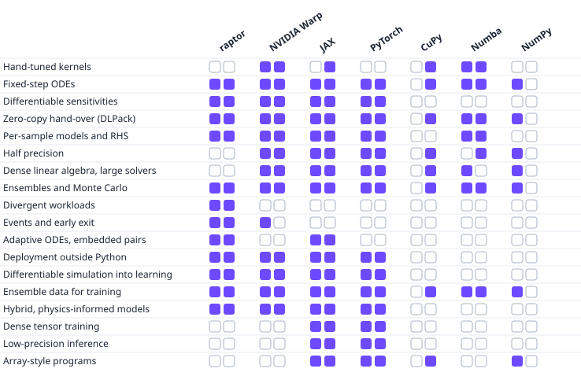

.. eagle documentation master file

.. raw:: html

   

     
   

eagle
=====

**One loop, recorded once, replayed until every sample is done.** eagle
runs a kernel over any number of samples — one or a million — without a
launch per sample: write the step once, and eagle captures it into a
single replayable launch, a CUDA graph on the GPU or an OpenMP + SIMD host
loop on the CPU, picked automatically from the data you pass in. A PyTorch
bridge lets that same kernel sit inside ``loss.backward()`` like any other
layer. (The name stands for *Extensible Adaptive Graph Launch Engine*, if
you're curious.) A header-only C++ core; a Python package over the same
engine.

.. raw:: html
   :file: _static/ecosystem/ecosystem_cards_eagle.html

.. raw:: html
   :file: content/_generated/perf_glimpse.html

Squares are filled where a tool's own documentation shows a designed way to do the work. How the tools compare on speed and
fit is on the `family site <https://amasat01.github.io/where_raptor_fits.html>`__.

Thirty seconds: ``eagle.simulate``
----------------------------------

Write one sample's step as a `hawk <https://amasat01.github.io/hawk/>`__
kernel, hand it to :func:`eagle.simulate`, and it runs every sample until
it is done — on the CPU or the GPU, no loop of your own:

.. code-block:: python

   @hawk.kernel
   def oscillator(omega: Scalar, t_end: Param, dt: Param, terminated: Terminated,
                  x: Mutable[Scalar], v: Mutable[Scalar], t: Mutable[Scalar]):
       x0, v0 = x, v
       x = x0 + dt * v0
       v = v0 - dt * omega * omega * x0
       t += dt
       terminated = t >= t_end

   result = eagle.simulate(oscillator, omega=omegas, t_end=1.0, dt=1e-3,
                           x=x0, v=v0, t=t0, max_steps=10_000)

Pass the kernel's own arguments as you would call it: an array gives each
sample its own value, a plain number is shared by every sample.

The full, runnable version is the :doc:`Python quickstart
<content/userguide/quickstart_python>` — start there.

Which call do I use?
---------------------

.. list-table::
   :header-rows: 0
   :widths: 60 40

   * - One kernel (or a step's worth), run until every sample finishes
     - :func:`eagle.simulate`
   * - A plan already paced by its own finish kernel, one call
     - :func:`eagle.until_done`
   * - Build a kernel into a plan that runs where its data lives
     - :func:`eagle.deploy` / :mod:`eagle.plan`
   * - Resolve a launchable by name, then call/stream/graph it
     - :class:`eagle.KernelRegistry`

This is ``eagle``'s own module docstring — the same four lines ``help(eagle)``
or ``eagle.__dir__()`` leads with. The full reference, every other call
eagle owns, is :doc:`content/api/api_python`.

.. grid:: 1
   :gutter: 2

   .. grid-item-card:: :octicon:`terminal` C++ users start here
      :link: content/userguide/foundations
      :link-type: doc

      eagle is a header-only C++23 library first: capture a CUDA graph,
      dispatch dual-mode CPU/GPU work, and more, with no Python runtime at
      all. :doc:`Foundations <content/userguide/foundations>` defines the
      vocabulary (``Stream``, ``Graph``, ``Launcher``); the
      :doc:`C++ quickstart <content/userguide/quickstart>` and
      :doc:`tutorials <content/userguide/tutorials>` build up from there —
      record a launch once, assemble it into a CUDA graph, and replay it,
      the same pattern ``eagle.simulate`` builds on in Python.

Where eagle sits
-----------------

eagle is the execution layer of the RAPTOR family — it launches what
`aether <https://amasat01.github.io/aether/>`__ lays out in memory, and what
`raptor <https://amasat01.github.io/raptor/>`__'s manifest schema describes:

.. code-block:: text

   aether (array layout)  --->  eagle (THIS: launch, graphs, host dispatch)  <---  raptor (manifest / interop contracts)
                                          ^
                                          |
                                        hawk (kernel compiler, consumes eagle to run what it compiles)

.. grid:: 2
   :gutter: 2

   .. grid-item-card:: :octicon:`desktop-download` Install
      :link: content/userguide/installation
      :link-type: doc

      C++ (header-only, CMake) and Python (``pip install "raptor-eagle[cuda12]"``, or ``[cuda13]``).

   .. grid-item-card:: :octicon:`rocket` Python quickstart
      :link: content/userguide/quickstart_python
      :link-type: doc

      ``eagle.simulate``, end to end, in under a minute. Start here.

   .. grid-item-card:: :octicon:`mortar-board` Tutorials
      :link: content/userguide/tutorials_python
      :link-type: doc

      Build up eagle's core patterns step by step: graphs, launch cadence,
      compaction, multi-kernel steps, training through a kernel — in
      Python, with a C++ track alongside.

   .. grid-item-card:: :octicon:`workflow` Build a graph
      :link: content/userguide/graph_forms
      :link-type: doc

      Write a step as a graph in code, in any of its forms: the how-to for
      ``eagle.Graph.builder``.

   .. grid-item-card:: :octicon:`code-square` API reference
      :link: content/api/api_reference
      :link-type: doc

      Complete C++ (Doxygen/breathe) and Python (autosummary) API reference.

.. toctree::
   :maxdepth: 1
   :caption: Start here
   :hidden:

   content/userguide/installation
   content/userguide/quickstart_python
   C++ quickstart <content/userguide/quickstart>

.. toctree::
   :maxdepth: 1
   :caption: Tutorials
   :hidden:

   content/userguide/tutorials_python

.. toctree::
   :maxdepth: 1
   :caption: How-to guides
   :hidden:

   content/userguide/howto

.. toctree::
   :maxdepth: 1
   :caption: Explanation
   :hidden:

   content/userguide/concepts

.. toctree::
   :maxdepth: 1
   :caption: Performance
   :hidden:

   content/performance

.. toctree::
   :maxdepth: 1
   :caption: Reference
   :hidden:

   content/api/api_reference
   content/api/api_python
   content/interop_contract
   content/userguide/build_options
   content/devguide/plugin_schema
   content/glossary

.. toctree::
   :maxdepth: 1
   :caption: Contributing
   :hidden:

   content/contributing

The RAPTOR family
------------------

.. list-table::
   :header-rows: 1
   :widths: 20 80

   * - Repository
     - Role
   * - `raptor <https://github.com/amasat01/raptor>`__
     - The shared contracts: manifest schema, engine/launcher/provider
       contracts, the interop certification matrix. No hard dependencies.
   * - `aether <https://github.com/amasat01/aether>`__
     - Zero-cost array layout and GPU memory management (SoA containers).
   * - **eagle** (this repository)
     - GPU execution layer: kernel launch, graph capture, plugin registry,
       host/device dual mode.
   * - `hawk <https://github.com/amasat01/hawk>`__
     - Symbolic/numeric DSL and kernel compiler: hawk compiles kernels
       eagle runs; neither imports the other.
